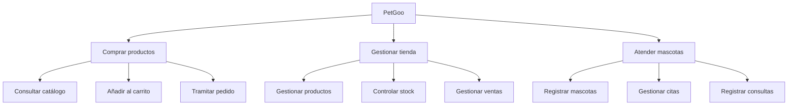

# PetGoo: Sistema de Información para la Gestión de una Tienda de Mascotas y Servicios Veterinarios

## Miembros del grupo L7-DF-4 

1. López Aguilera, Manuel
1. Sánchez García, Antonio Manuel
1. Adardour,Ferdaouss
1. Zhou, You

## 1. Introducción al problema

La tienda de animales PETGOO se dedica a la comercialización de productos de alimentación, accesorios y productos de higiene para mascotas, incluyendo además servicios de transporte y envío a domicilio.

Actualmente, la gestión del inventario, concertación e historial de citas, las ventas y los pedidos se realizan de forma parcial mediante herramientas no centralizadas y hojas de cálculo manuales. Esta situación provoca inconsistencias en el stock, errores administrativos, dificultades para consultar información actualizada y limita la posibilidad de comercializar los productos a través de plataformas digitales.

Con el objetivo de modernizar y expandir el negocio, la empresa ha decidido desarrollar una plataforma web de comercio electrónico y gestión centralizada. El nuevo sistema permitirá integrar en una única aplicación la gestión del catálogo de productos, clientes, empleados, veterinarios, pedidos, ventas, stock y envíos.

El sistema deberá permitir que la información generada durante las distintas operaciones quede centralizada y sea accesible por los usuarios autorizados. De este modo, se pretende reducir la duplicidad de datos y los errores derivados de la gestión manual.

Asimismo, la plataforma permitirá ampliar el canal de ventas de la empresa mediante el comercio electrónico, ofreciendo a los clientes la posibilidad de realizar compras sin necesidad de acudir físicamente al establecimiento. Los empleados podrán gestionar dichos pedidos desde la misma plataforma utilizada para las operaciones realizadas en tienda.

Con la implantación del sistema se espera mejorar el control del inventario, agilizar la gestión de pedidos y ventas y ofrecer una mejor experiencia de compra a los clientes.

## 2. Glosario de términos
No hay ningún término de difícil entendimiento.

## 3. Visión general del sistema
El sistema consiste en una plataforma web destinada a centralizar la gestión de una tienda de mascotas y a proporcionar un canal de venta online integrado con la actividad del establecimiento físico.

La aplicación permitirá trabajar con la información generada por las diferentes áreas del negocio desde un único sistema. De esta forma, los datos relacionados con productos, categorías, clientes, empleados, pedidos, ventas, inventario y envíos estarán conectados entre sí y podrán ser gestionados de acuerdo con los permisos de cada usuario.

El sistema se plantea como una solución única para dos ámbitos de actividad: la gestión interna de la tienda y la venta online. Las operaciones realizadas en el establecimiento y las realizadas mediante la plataforma web formarán parte del mismo sistema, permitiendo mantener una información común y actualizada

### 3.1. Requisitos generales

RG-1. Gestionar el inventario

Como empleado, 

quiero gestionar el inventario de productos, 

para conocer y mantener actualizada la disponibilidad de mercancía de la tienda.

RG-2. Gestionar los pedidos

Como empleado, 

quiero gestionar los pedidos de la tienda, 

para controlar las operaciones de compra realizadas tanto de forma presencial como online.

RG-4. Gestionar los envíos

Como empleado, 

quiero gestionar los envíos asociados a los pedidos online, 

para controlar la entrega de los productos a los clientes.

RG-8. Gestionar la información de las mascotas
Como veterinario,

quiero gestionar la información de las mascotas 

para poder realizar y mantener actualizada la atención veterinaria ofrecida a los clientes.

RG-7. Gestionar citas veterinarias,

Como veterinario,

quiero gestionar  las  citas veterinarias,

para poder realizar y mantener actualizada la atención veterinaria ofrecida a los clientes.

RG- ?????????????????????????

### 3.2. Usuarios del sistema
Para garantizar la seguridad y el correcto flujo de trabajo, el sistema contempla diferentes perfiles de usuarios. Cada usuario tendrá permisos específicos adaptados a sus responsabilidades dentro del negocio:

Gerente
Es el usuario con control total sobre el sistema.

Veterinario
El profesional de salud animal cualificado para atender en consultas.

Cliente
Es el usuario final que va a consumir los servicios que proporciona nuestro negocio.

## 4. Catálogo de requisitos

### 4.1. Requisitos funcionales

#### R.F.01. Gestionar productos del catálogo
Como Gerente, 
quiero dar de alta, modificar y dar de baja productos del catálogo, 
para mantener actualizada la oferta de productos de la tienda.

#### **Prueba de aceptación**
- Se debe comprobar que el gerente pueda dar de alta un producto con sus datos obligatorios.
- Se debe comprobar que el gerente pueda modificar los datos de un producto existente.
- Se debe comprobar que el gerente pueda dar de baja un producto del catálogo.
- Se debe aplicar la regla de negocio RN-003 para comprobar que no se permita registrar un producto con un precio igual o inferior a 0,00 €.

#### R.F.02. Gestionar categorías de productos
Como Gerente, 
quiero gestionar las categorías de los productos,
para mantener organizado el catálogo de la tienda.
 
####  **Prueba de aceptación**
- Se debe comprobar que el gerente pueda crear una nueva categoría.
- Se debe comprobar que el gerente pueda modificar una categoría existente.
- Se debe comprobar que el gerente pueda asociar productos a las categorías correspondientes.
- Se debe comprobar que los cambios realizados en las categorías queden guardados correctamente.
 
#### R.F.03. Consultar el catálogo de productos
Como cliente, 
quiero consultar los productos disponibles en el catálogo, 
para conocer los artículos que puedo adquirir en la tienda.

#### **Prueba de aceptación**
- Se debe comprobar que el cliente pueda consultar los productos disponibles en el catálogo.
- Se debe comprobar que cada producto muestre su información relevante, incluido el nombre y el precio.
- Se debe comprobar que los productos aparezcan organizados por categorías.
- Se debe comprobar que los precios mostrados coincidan con los registrados en el sistem

#### R.F.04. Gestionar precios de productos
Como Gerente, 
quiero modificar los precios de los productos del catálogo, 
para mantener actualizados los precios de venta de la tienda.

#### **Prueba de aceptación**
- Se debe comprobar que el gerente pueda modificar el precio de un producto existente.
- Se debe comprobar que el nuevo precio quede guardado correctamente.
- Se debe comprobar que el precio actualizado se muestre en el catálogo.
- Se debe aplicar la regla de negocio RN-003 para impedir que se establezcan precios iguales o inferiores a 0,00 €.

#### R.F.05. Modificar precios de productos de forma localizada
Como dependiente, 
quiero modificar el precio de determinados productos, 
para actualizar los precios que necesiten cambios durante la actividad de la tienda. 

#### **Prueba de aceptación**
- Se debe comprobar que el dependiente pueda modificar el precio de un producto dentro de sus permisos.
- Se debe comprobar que el nuevo precio quede guardado correctamente.
- Se debe comprobar que el dependiente no pueda modificar precios de productos para los que no tenga autorización.
- Se debe aplicar la regla de negocio RN-003 para impedir que se establezcan precios iguales o inferiores a 0,00 €.

#### R.F.06. Consultar y actualizar el inventario
Como dependiente,
quiero consultar y actualizar el stock de los productos, 
para mantener controlada la disponibilidad de mercancía de la tienda.

#### **Prueba de aceptación**
- Se debe comprobar que el dependiente pueda consultar el stock disponible de un producto.
- Se debe comprobar que pueda actualizar las existencias según sus permisos.
- Se debe comprobar que el sistema refleje correctamente las cantidades actualizadas.
- Se debe aplicar la regla de negocio RN-001 para impedir que el stock de un producto sea inferior a cero.

#### R.F.07. Realizar auditorías de inventario
Como Gerente,
quiero realizar auditorías del inventario, 
para comprobar que las existencias registradas coinciden con las existencias reales de la tienda.

#### **Prueba de aceptación**
- Se debe comprobar que el gerente pueda consultar las existencias registradas.
- Se debe comprobar que pueda registrar los resultados de un recuento físico.
- Se debe comprobar que se puedan identificar las diferencias entre el stock real y el registrado.
- Se debe aplicar la regla de negocio RN-001 para garantizar que el stock registrado nunca sea negativo.

#### R.F.08. Registrar clientes
Como dependiente, 
quiero registrar nuevos clientes, 
para disponer de su información y poder gestionar sus compras y servicios.

#### **Prueba de aceptación**
- Se debe comprobar que el dependiente pueda registrar un nuevo cliente con los datos obligatorios.
- Se debe comprobar que los datos del cliente queden almacenados correctamente.
- Se debe comprobar que el cliente registrado pueda localizarse posteriormente.
- Se debe aplicar la regla de negocio RN-006 para impedir que dos usuarios tengan el mismo correo electrónico.

#### R.F.09. Gestionar datos de clientes
Como Gerente, 
quiero consultar y modificar la información de los clientes, 
para mantener sus datos actualizados.

#### **Prueba de aceptación**
- Se debe comprobar que el gerente pueda consultar los datos de un cliente registrado.
- Se debe comprobar que pueda modificar los datos permitidos.
- Se debe comprobar que los cambios queden guardados correctamente.
- Se debe aplicar la regla de negocio RN-006 para impedir que se registre un correo electrónico que ya pertenezca a otro usuario.

#### R.F.10. Registro y autenticación de usuarios
Como cliente, 
quiero crear una cuenta en la plataforma e iniciar sesión,
para gestionar mis datos personales, direcciones y realizar pedidos online.

#### **Prueba de aceptación**
- Se debe comprobar que un cliente pueda crear una cuenta proporcionando los datos obligatorios.
- Se debe comprobar que un usuario registrado pueda iniciar sesión con sus credenciales correctas.
- Se debe comprobar que el sistema rechace el inicio de sesión cuando las credenciales sean incorrectas.
- Se debe aplicar la regla de negocio RN-006 para impedir que dos usuarios tengan el mismo correo electrónico.

#### RF-11. Gestionar direcciones de entrega
Como Cliente, 
quiero añadir, modificar y seleccionar direcciones de entrega, 
para agilizar la confirmación de pedidos online.

#### **Prueba de aceptación**
- Se debe comprobar que el cliente pueda añadir una nueva dirección de entrega.
- Se debe comprobar que pueda modificar una dirección previamente registrada.
- Se debe comprobar que pueda seleccionar una de sus direcciones al tramitar un pedido.
- Se debe comprobar que un cliente no pueda modificar ni consultar las direcciones privadas de otro cliente.

#### R.F.12. Tramitación de pedidos online (Carrito de compra)
Como cliente, 
quiero añadir productos al carrito, seleccionar dirección de envío y método de pago para realizar el pedido, 
para comprar los productos desde la plataforma web.

#### **Prueba de aceptación**
- Se debe comprobar que el cliente pueda añadir productos al carrito y modificar las cantidades.
- Se debe comprobar que el sistema calcule correctamente el importe de los productos seleccionados.
- Se debe comprobar que el sistema aplique los gastos de envío correspondientes: 0,00 € si el importe de los productos supera los 70,00 €, y 4,95 € en caso contrario.
- Se debe aplicar la regla de negocio RN-002 para impedir que se tramite un pedido cuyo importe no sea superior a 20,00 €.
- Se debe aplicar la regla de negocio RN-003 para garantizar que los productos tengan precios positivos.
- Se debe aplicar la regla de negocio RN-001 para impedir que el stock resulte negativo al tramitar el pedido.

#### R.F.13. Consulta de historial de ventas y reportes
Como Gerente, 
quiero consultar el historial de ventas filtrado por fechas, cliente o empleado, 
para analizar los ingresos e impacto comercial.

#### **Prueba de aceptación**
- Se debe comprobar que el gerente pueda consultar el historial de ventas.
- Se debe comprobar que pueda filtrar las ventas por fecha, cliente o empleado.
- Se debe comprobar que los resultados coincidan con las ventas registradas según los filtros seleccionados.
- Se debe comprobar que los importes mostrados correspondan con los datos almacenados en el sistema.

#### RF-14. Gestionar citas veterinarias
Como cliente , 
quiero  solicitar, confirmar o cancelar citas , 
para organizar la agenda de atención veterinaria.

#### **Prueba de aceptación**
- Se debe comprobar que el cliente pueda consultar los horarios disponibles para solicitar una cita.
- Se debe comprobar que pueda solicitar una cita para una de sus mascotas.
- Se debe comprobar que pueda cancelar una cita cuando corresponda.
- Se debe comprobar que las citas creadas o canceladas se reflejen correctamente en la agenda veterinaria.

#### R.F.15. Consultar pedidos y ventas del cliente
Como cliente, 
quiero consultar mis pedidos y compras realizadas, 
para conocer el estado y el historial de mis operaciones con la tienda.

#### **Prueba de aceptación**
- Se debe comprobar que el cliente pueda consultar sus pedidos online.
- Se debe comprobar que pueda consultar el estado de cada pedido.
- Se debe comprobar que pueda consultar el historial de sus compras.
- Se debe comprobar que no pueda acceder a los pedidos o compras de otros clientes.

#### R.F.16. Gestionar pedidos online
Como dependiente, 
quiero gestionar los pedidos realizados mediante la plataforma web, 
para preparar y controlar las compras realizadas por los clientes.

#### **Prueba de aceptación**
- Se debe comprobar que el dependiente pueda consultar los pedidos online registrados.
- Se debe comprobar que pueda consultar los productos y las cantidades de cada pedido.
- Se debe comprobar que pueda actualizar el estado del pedido durante su preparación.
- Se debe aplicar la regla de negocio RN-001 para garantizar que la gestión de los pedidos no provoque que el stock sea negativo.

#### R.F.17. Consultar agenda 
Como veterinario
quiero consultar las citas q tengo asignadas
para organizar mi jornada de trabajo.

#### **Prueba de aceptación**
- Se debe comprobar que el veterinario pueda consultar las citas que tiene asignadas.
- Se debe comprobar que las citas aparezcan en las fechas y horarios correspondientes.
- Se debe comprobar que se muestre la información necesaria para identificar cada cita y la mascota.
- Se debe comprobar que los cambios realizados en las citas se reflejen correctamente en la agenda.

#### RF-18. Registrar consulta clínica
Como Veterinario, 
quiero crear la consulta correspondiente a una cita atendida y registrar observaciones, 
para mantener el historial clínico.

#### **Prueba de aceptación**
- Se debe comprobar que el veterinario pueda registrar una consulta asociada a una cita atendida.
- Se debe comprobar que pueda introducir observaciones clínicas.
- Se debe comprobar que la consulta quede asociada a la mascota correspondiente.
- Se debe comprobar que la información registrada pueda consultarse posteriormente en el historial clínico.

#### RF-19. Consultar historial de una mascota
Como Cliente o veterinario , 
quiero consultar citas, y consultas según los permisos del perfil, 
para disponer de la información relevante de la mascota.

#### **Prueba de aceptación**
- Se debe comprobar que el veterinario pueda consultar el historial clínico de las mascotas autorizadas.
- Se debe comprobar que el cliente pueda consultar la información veterinaria de sus propias mascotas que tenga permitida.
- Se debe comprobar que el historial muestre las citas y consultas registradas.
- Se debe comprobar que el cliente no pueda acceder al historial de mascotas pertenecientes a otros clientes.

#### R.F.20. Gestionar envíos
Como dependiente, 
quiero gestionar los envíos asociados a los pedidos online, 
para controlar la entrega de los productos a los clientes.

#### **Prueba de aceptación**
- Se debe comprobar que el dependiente pueda consultar los envíos asociados a los pedidos online.
- Se debe comprobar que pueda registrar o modificar los datos del envío.
- Se debe comprobar que pueda actualizar el estado del envío.
- Se debe comprobar que cada envío quede asociado al pedido correspondiente.

#### R.F.21. Cancelar pedidos online
Como cliente, 
quiero cancelar mis pedidos online cuando sea posible, 
para poder anular una compra que ya no deseo realizar.

#### **Prueba de aceptación**
- Se debe comprobar que el cliente pueda consultar sus pedidos para seleccionar el que desea cancelar.
- Se debe comprobar que pueda cancelar un pedido cuando cumpla las condiciones establecidas.
- Se debe comprobar que el sistema actualice el estado del pedido tras aceptar la cancelación.
- Se debe comprobar que el sistema impida cancelar un pedido cuando ya no sea posible hacerlo según las condiciones del negocio.

#### R.F.22. Gestionar usuarios y permisos
Como gerente, quiero dar de alta y baja usuarios y gestionar sus permisos, para controlar el acceso a las diferentes funciones del sistema según sus responsabilidades.

#### **Prueba de aceptación**
- Se debe comprobar que el gerente pueda dar de alta un usuario y asignarle un perfil.
- Se debe comprobar que pueda modificar los permisos de un usuario.
- Se debe comprobar que pueda dar de baja a un usuario.
- Se debe comprobar que cada usuario solo pueda acceder a las funciones autorizadas para su perfil.
- Se debe aplicar la regla de negocio RN-006 para impedir que dos usuarios tengan el mismo correo electrónico.
- Se debe aplicar la regla de negocio RN-006 para impedir que dos empleados tengan el mismo DNI.

### 4.1.1. Requisitos de información
#### RI-001: Información de usuarios (Clientes, Empleados y Gerentes)
Como Gerente del sistema,
quiero almacenar la información identificativa de los usuarios: 
              ID de Usuario (único), Nombre, Apellidos, Correo electrónico (único), Teléfono, Nombre              de usuario, Contraseña, Foto de perfil y Rol (Cliente, Empleado, Gerente).
              En el caso de los Clientes: Direcciones de entrega guardadas. 
              En el caso de los Empleados: DNI (único) y Fecha de contratación.  
para autenticar a los usuarios y gestionar las operaciones comerciales de forma personalizada. 

 #### **Prueba de aceptación**
-Comprobar que se puede registrar un usuario con su ID, nombre, apellidos, correo electrónico, teléfono, nombre de usuario, contraseña y rol.

-Comprobar que no se permite registrar dos usuarios con el mismo ID.

-Comprobar que no se permite registrar dos usuarios con el mismo correo electrónico.

-Comprobar que se pueden registrar usuarios con los roles de Cliente, Empleado o Gerente.

-Comprobar que los empleados pueden registrar su DNI y fecha de contratación.

-Comprobar que no se permite registrar dos empleados con el mismo DNI.

-Comprobar que los clientes pueden guardar y consultar sus direcciones de entrega.

-Comprobar que se puede consultar y actualizar la información de un usuario según los permisos de su rol.

-Comprobar que las contraseñas se almacenan de forma segura y no se muestran en texto legible.

#### RI-002: Información de animales
Como empleado de la tienda,
quiero almacenar la información de las mascotas de los clientes:
ID de Mascota (único), Nombre, Especie, Raza, Sexo, Fecha de nacimiento, Imagen/Foto y Cliente propietario asociado,
para llevar un control individualizado de cada mascota y poder relacionarla con sus citas y servicios veterinarios.

#### **Prueba de aceptación**
-Comprobar que se puede registrar una mascota con su ID, nombre, especie, raza, sexo, fecha de nacimiento, 
fotografía y cliente propietario.

-Comprobar que no se permite registrar dos mascotas con el mismo ID.

-Comprobar que cada mascota queda asociada a un cliente propietario registrado.

-Comprobar que se puede consultar la información de una mascota.

-Comprobar que se puede modificar la información de una mascota cuando sea necesario.

-Comprobar que se puede guardar y consultar la fotografía de una mascota.

-Comprobar que se pueden consultar todas las mascotas asociadas a un cliente.

#### RI-003: Información de productos y categorías
Como empleado,
quiero almacenar la información de los productos y sus categorías: 
Producto: ID de Producto (único), Nombre, Descripción, Precio (€), Stock (unidades) y Foto.
Categoría: ID de Categoría (único), Nombre y Descripción. 
Cada producto estará asociado a una categoría ,
para organizar el catálogo de productos y mantener actualizada la información del inventario.

#### **Prueba de aceptación**
-Comprobar que se puede registrar un producto con su ID, nombre, descripción, precio, stock y fotografía.

-Comprobar que no se permite registrar dos productos con el mismo ID.

-Comprobar que el precio de un producto debe ser estrictamente superior a 0 €.

-Comprobar que el stock de un producto no puede ser negativo.

-Comprobar que se puede registrar una categoría con su ID, nombre y descripción.

-Comprobar que no se permite registrar dos categorías con el mismo ID.

-Comprobar que cada producto queda asociado a una categoría existente.

-Comprobar que se pueden consultar los productos pertenecientes a una categoría.

-Comprobar que un producto puede estar asociado a uno o varios proveedores.

-Comprobar que se puede consultar y actualizar la información de productos y categorías según los permisos correspondientes.

#### RI-004: Información de proveedores
Como Gerente, 
quiero registrar los datos de contacto de los proveedores: 
ID de Proveedor (único), Nombre de la empresa, CIF/DNI, Teléfono, Correo electrónico y Dirección postal. 
para mantener la trazabilidad de la procedencia de los artículos.

#### **Prueba de aceptación**
-Comprobar que se puede registrar un proveedor con su ID, nombre de empresa, identificador fiscal, teléfono, correo electrónico y dirección postal.

-Comprobar que no se permite registrar dos proveedores con el mismo ID.

-Comprobar que se puede consultar la información de un proveedor registrado.

-Comprobar que se pueden actualizar los datos de contacto de un proveedor.

-Comprobar que se puede consultar qué productos suministra cada proveedor.

-Comprobar que un proveedor puede suministrar varios productos.

-Comprobar que un producto puede estar asociado a varios proveedores.

#### RI-005: Información de pedidos
Como gerente del sistema,
quiero almacenar la información correspondiente a los pedidos y las compras realizadas en PetGoo, incluyendo:
Pedido: ID de pedido (único), fecha y hora de creación, cliente asociado, empleado responsable (cuando se trate de una venta presencial), estado del pedido (Pendiente, En preparación, Enviado, Entregado o Cancelado), forma de pago (Tarjeta o Efectivo), canal de compra (Online o Presencial), dirección de envío (cuando corresponda), gastos de envío e importe total (€).
Líneas de pedido: producto asociado, cantidad adquirida, precio unitario aplicado en el momento de la compra y subtotal de la línea.
Cada pedido estará asociado a un cliente y contendrá las líneas correspondientes a los productos adquiridos. En las compras presenciales se registrará el empleado responsable, mientras que en los pedidos online se almacenará la dirección de envío cuando sea necesaria.
para emitir justificantes de compra, mantener un registro de las operaciones comerciales y facilitar el seguimiento de los pedidos y las ventas.

#### **Prueba de aceptación**
-Comprobar que se puede registrar un pedido con su ID, fecha y hora, cliente asociado, canal de compra, estado, forma de pago e importe total.

-Comprobar que no se permite registrar dos pedidos con el mismo ID.

-Comprobar que se pueden asociar una o varias líneas de pedido, indicando el producto, la cantidad, el precio unitario y el subtotal.

-Comprobar que se registra el empleado responsable cuando el pedido corresponde a una venta presencial.

-Comprobar que se registra la dirección de envío cuando el pedido online requiere entrega a domicilio.

-Comprobar que los gastos de envío se calculan de acuerdo con las reglas de negocio establecidas.

-Comprobar que el importe total se corresponde con la suma de los subtotales de las líneas y los gastos aplicables.

-Comprobar que el importe de los productos debe ser estrictamente superior a 20 € para que el pedido pueda tramitarse.

-Comprobar que los gastos de envío son gratuitos cuando el importe de los productos supera los 70 € y que, en caso contrario, ascienden a 4,95 €.

-Comprobar que, al completarse una venta, el stock de cada producto se reduce automáticamente según la cantidad adquirida.

-Comprobar que una venta no puede provocar que el stock de un producto sea negativo.

-Comprobar que se puede consultar la información de un pedido para emitir su justificante de compra y realizar su seguimiento.

#### RI-006: Información de direcciones de entrega
Como cliente,
quiero registrar mis direcciones de entrega: 
ID de Dirección (único), Calle, Número, Piso/Puerta, Código Postal, Localidad, Provincia y Campo indicador de dirección seleccionada por defecto.
Para agilizar el proceso de compra online.

#### **Prueba de aceptación**
-Comprobar que un cliente puede registrar una dirección con su ID, calle, número, piso o puerta, código postal, localidad y provincia.

-Comprobar que no se permite registrar dos direcciones con el mismo ID.

-Comprobar que cada dirección queda asociada al cliente correspondiente.

-Comprobar que un cliente puede guardar varias direcciones de entrega.

-Comprobar que el cliente puede consultar y modificar sus direcciones guardadas.

-Comprobar que el cliente puede seleccionar una dirección como predeterminada.

-Comprobar que un cliente no puede tener más de una dirección predeterminada al mismo tiempo.

-Comprobar que se puede seleccionar una dirección guardada durante la tramitación de un pedido online.

#### RI-007: Información de citas veterinarias
Como empleado de la tienda,
quiero almacenar la información acerca de las citas veterinarias:
ID de Cita (único), Fecha, Hora, Estado de la cita (Solicitada, Confirmada, Cancelada, Atendida), Motivo de la cita, Mascota asociada y Veterinario asignado.
Para organizar la agenda veterinaria y mantener un registro de las citas solicitadas por los clientes.

#### **Prueba de aceptación**
-Comprobar que se puede registrar una cita con su ID, fecha, hora, estado, motivo, mascota asociada y veterinario asignado.

-Comprobar que no se permite registrar dos citas con el mismo ID.

-Comprobar que cada cita queda asociada a una mascota registrada.

-Comprobar que se puede asignar un veterinario a una cita.

-Comprobar que se puede consultar la agenda de citas de un veterinario.

-Comprobar que se pueden consultar las citas asociadas a una mascota.

-Comprobar que el estado de una cita solo puede tomar los valores permitidos: Solicitada, Confirmada, Cancelada o Atendida.

-Comprobar que se puede registrar una solicitud de cita y actualizar su estado cuando se confirma, cancela o atiende.

-Comprobar que las citas atendidas quedan identificadas con el estado correspondiente.

#### RI-008: Información de consultas veterinarias
Como veterinario,
quiero almacenar la información correspondiente a las consultas realizadas:
ID de Consulta (único), Fecha y hora de realización, Observaciones clínicas, Cita asociada, Mascota atendida y Veterinario responsable.
Para mantener actualizado el historial clínico de cada mascota.

#### **Prueba de aceptación**
-Comprobar que se puede registrar una consulta con su ID, fecha y hora de realización, observaciones clínicas, mascota atendida y veterinario responsable.

-Comprobar que no se permite registrar dos consultas con el mismo ID.

-Comprobar que cada consulta queda asociada a la mascota atendida.

-Comprobar que cada consulta identifica al veterinario responsable.
ç
-Comprobar que se puede asociar una consulta a la cita veterinaria correspondiente.

-Comprobar que se puede consultar el historial de consultas de una mascota.

-Comprobar que el veterinario puede registrar y consultar la información clínica de las consultas que atiende.

-Comprobar que los usuarios que no disponen de permisos veterinarios no pueden acceder a la información clínica confidencial.

-Comprobar que las observaciones clínicas registradas se conservan y pueden consultarse posteriormente por los usuarios autorizados.

#### 4.1.2. Reglas de negocio

##### RN-001: Stock no negativo
El número de unidades en stock de un producto nunca podrá ser menor que cero. 

##### RN-002: Precio mínimo pedido 
El precio mínimo de pedido para que se tramite debe ser superior a 20 euros. 

##### RN-003: Precios positivos
El precio unitario de cualquier producto  debe ser estrictamente mayor que 0,00 €. 

##### RN-004: Actualización automática de stock
Al completar una venta de productos, el stock de cada artículo vendido se decrementará automáticamente según la cantidad comprada.

##### RN-005: Gastos de envío gratuitos por pedido mínimo
Si el importe total de los productos en el pedido  supera los 70,00 €, los gastos de envío serán gratuitos (0,00 €). De lo contrario, se aplicará una tarifa fija de 4,95 €. 

##### RN-006: Unicidad de correo electrónico y DNI
No podrán existir dos usuarios con el mismo correo electrónico ni dos empleados con el mismo DNI.

### 4.2. Mapa de historias de usuario

El mapa de historias de usuario de PetGoo permite organizar las funcionalidades del sistema según las actividades principales que realizan los distintos tipos de usuarios. Se estructura en actividades generales y tareas más específicas, facilitando la comprensión del alcance del sistema y la relación entre las necesidades de los usuarios y los requisitos funcionales definidos.

| Actividad principal | Historias de usuario |
|---|---|
| **Gestionar usuarios y clientes** | Registrar usuarios, iniciar sesión, gestionar permisos y mantener actualizados los datos de los clientes. |
| **Gestionar catálogo e inventario** | Gestionar productos y categorías, consultar el catálogo, actualizar precios, consultar existencias y realizar auditorías de inventario. |
| **Gestionar compras y pedidos** | Añadir productos al carrito, tramitar pedidos online, consultar compras, cancelar pedidos y gestionar pedidos recibidos. |
| **Gestionar ventas** | Registrar las operaciones presenciales, consultar el historial de ventas y supervisar la actividad comercial. |
| **Gestionar entregas** | Guardar direcciones de entrega y gestionar los envíos asociados a pedidos online. |
| **Gestionar servicios veterinarios** | Registrar mascotas, solicitar y gestionar citas, consultar agendas y registrar consultas veterinarias. |
| **Supervisar el negocio** | Consultar información de ventas, controlar el inventario y gestionar proveedores y reposiciones. |
### 4.3. Requisitos no funcionales 

**R.N.F. 01. Usabilidad**
Como usuario del sistema, 
quiero que la plataforma sea sencilla e intuitiva de utilizar, 
para poder realizar las operaciones correspondientes a mi función sin dificultades.

**R.N.F. 02. Rendimiento**
Como usuario del sistema, 
quiero que la búsqueda de catálogo y la confirmación de pedidos respondan en menos de 2 segundos, 
para asegurar una experiencia fluida y sin interrupciones.

**R.N.F. 03. Disponibilidad**
Como cliente, 
quiero que la plataforma esté disponible durante la mayor parte del tiempo, 
para poder consultar el catálogo y realizar compras cuando lo necesite.

**R.N.F. 04. Seguridad**
Como usuario del sistema, 
quiero que el acceso a la plataforma esté protegido mediante autenticación, 
para evitar que personas no autorizadas puedan acceder a la información del sistema.

**R.N.F. 05. Control de acceso**
Como Gerente, 
quiero que cada usuario tenga acceso únicamente a las funciones que correspondan a su rol, 
para proteger la información y evitar operaciones no autorizadas.

**R.N.F. 06. Fiabilidad**
Como empleado, 
quiero que la información registrada en el sistema se mantenga íntegra y consistente, 
para poder confiar en los datos de productos, inventario, ventas y pedidos.

**R.N.F.07. Compatibilidad**
Como usuario, 
quiero poder utilizar la plataforma desde los principales navegadores web y diferentes dispositivos, 
para poder acceder al sistema independientemente del dispositivo utilizado.

**R.N.F. 08. Mantenibilidad**
Como responsable del sistema, 
quiero que la aplicación esté organizada de forma que facilite su mantenimiento y actualización, 
para poder corregir errores o incorporar mejoras sin afectar innecesariamente al resto del sistema.

-- fin entregable 1 --

## 5. Modelo conceptual

### 5.1. Diagramas de clases UML

- con restricciones.

### 5.2. Escenarios de prueba

- con descripción textual y diagrama de objetos UML.

## 6. Matrices de trazabilidad

- Matriz de trazabilidad entre los elementos del modelo conceptual y los requisitos.

|       | EntidadX   | AsociaciónX  | RestricciónX  | Entidad2 ...   | 
|:------|:-----------|:-----------|:-----------|:-----------|
| RI-1  | X          | X          | X          | X          |
| RI-2  |            | X          |            | X          |
| RF-1  |            | X          |            | X          |
| RF-2  | X          |            | X          | X          |
| RN-1  |            | X          |            |            |
| RN-2  | X          | X          | X          |            |
| ...   |            |            |            |            |

-- fin entregable 2 --

## 7. Modelo relacional en 3FN

- Relaciones obtenidas al aplicar la transformación del modelo conceptual.

### 7.1.  Justificación de la estrategia de transformación de jerarquías

- si se identificaron jerarquías en el MC.

### 8. Matriz de trazabilidad MC/SQL (opcional):

- Restricciones sobre el MC / Elementos del modelo tecnológico (SQL) (Triggers, checks, etc.)
- Incluir Reglas de negocio — Constraints/Triggers en las matrices de trazabilidad para el entregable 3

|       | EntidadX   | AsociaciónX  | RestricciónX  | Entidad2 ...   | 
|:-------|:-------|:-------|:-------|:-------|
| TABLA-1 |        |        |        |        |
| TABLA-2 |        |        |        |        |
| TABLA-3 |        |        |        |        |
| TABLA-4 |        |        |        |        |
| TRIG-1 |        |        |        |        |
| TRIG-2 | X      | X      |        | X      |
| TRIG-3 |        | X      |        | X      |
| TRIG-4 |        |        | X      |        |
| CONST-1 |        |        |        |        |
| CONST-2 | X      | X      |        | X      |
| CONST-3 |        | X      |        | X      |
| CONST-4 |        |        | X      |        |

Se consideran todo tipo de constraints declarativas (aquellas definidas durante el CREATE TABLE).
-- fin entregable 3 --

## Referencias

