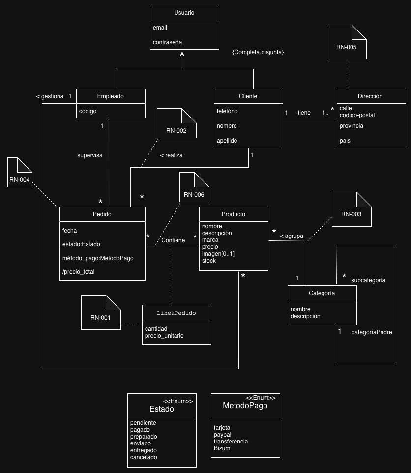
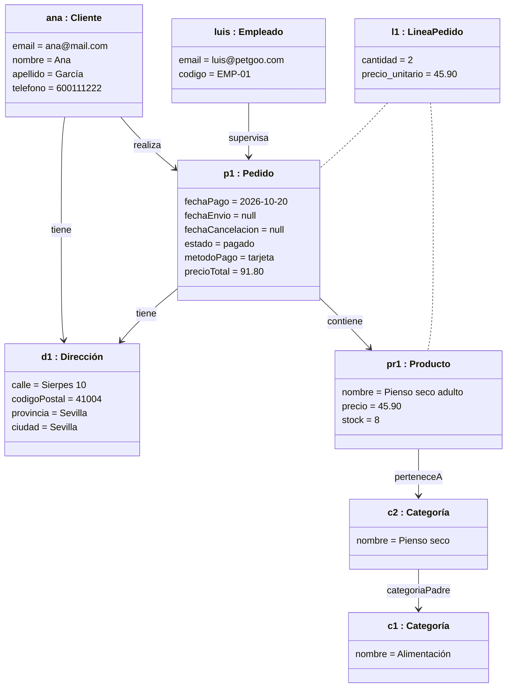

# PetGoo: Sistema de Información para la Gestión de una Tienda de Mascotas

## Miembros del grupo L7-DF-4 

1. López Aguilera, Manuel
1. Sánchez García, Antonio Manuel
1. Adardour,Ferdaouss
1. Zhou, You

## 1. Introducción al problema

La tienda de animales PETGOO se dedica a la comercialización de productos de alimentación, accesorios y productos de higiene para mascotas.

Actualmente, la gestión del inventario, las ventas y los pedidos se realizan de forma parcial mediante herramientas no centralizadas y hojas de cálculo manuales. Esta situación provoca inconsistencias en el stock, errores administrativos, dificultades para consultar información actualizada y limita la posibilidad de comercializar los productos a través de plataformas digitales.

Con el objetivo de modernizar y expandir el negocio, la empresa ha decidido desarrollar una plataforma web de comercio electrónico y gestión centralizada. El nuevo sistema permitirá integrar en una única aplicación la gestión del catálogo de productos, clientes, empleados, pedidos, ventas, stock y envíos.

El sistema deberá permitir que la información generada durante las distintas operaciones quede centralizada y sea accesible por los usuarios autorizados. De este modo, se pretende reducir la duplicidad de datos y los errores derivados de la gestión manual.

Asimismo, la plataforma permitirá ampliar el canal de ventas de la empresa mediante el comercio electrónico, ofreciendo a los clientes la posibilidad de realizar compras sin necesidad de acudir físicamente al establecimiento. Los empleados podrán gestionar dichos pedidos desde la misma plataforma utilizada para las operaciones realizadas en tienda.

Con la implantación del sistema se espera mejorar el control del inventario, agilizar la gestión de pedidos y ventas y ofrecer una mejor experiencia de compra a los clientes.

## 2. Glosario de términos
No hay ningún término de difícil entendimiento.

## 3. Visión general del sistema
El sistema consiste en una plataforma web destinada a centralizar la gestión de una tienda de mascotas y a proporcionar un canal de venta online integrado con la actividad del establecimiento físico.

La aplicación permitirá trabajar con la información generada por las diferentes áreas del negocio desde un único sistema. De esta forma, los datos relacionados con productos, categorías, clientes, empleados, pedidos, ventas, inventario y envíos estarán conectados entre sí y podrán ser gestionados de acuerdo con los permisos de cada usuario.

El sistema se plantea como una solución única para dos ámbitos de actividad: la gestión interna de la tienda y la venta online. Las operaciones realizadas en el establecimiento y las realizadas mediante la plataforma web formarán parte del mismo sistema, permitiendo mantener una información común y actualizada

### 3.1. Requisitos generales

RG-1. Gestionar el inventario

Como empleado, 

quiero gestionar el inventario de productos, 

para conocer y mantener actualizada la disponibilidad de mercancía de la tienda.

RG-2. Gestionar los pedidos

Como empleado, 

quiero gestionar los pedidos de la tienda, 

para controlar las operaciones de compra realizadas tanto de forma  online.

RG-3.Realizar pedidos online

Como cliente, 

quiero seleccionar productos y confirmar un pedido por internet,

para comprar sin desplazarme a la tienda.
 
RG-4 Procesamiento de Pagos y Selección de Método

Como cliente,

quiero realizar el pago de mi pedido mediante distintos métodos de pago,

para completar la compra de forma cómoda .
 
RG-5: Consultar mis pedidos

Como cliente,

quiero consultar el historial de mis pedidos y su estado (pendiente,pagado,preparado,enviado,entregado,cancelado), 

para hacer un seguimiento de mis compras.

RG-6. Gestionar clientes y cuentas
Como cliente,

quiero registrarme y gestionar mis datos y direcciones de envío, 

para recibir mis pedidos y acceder a mi cuenta.

RG-7. Gestionar el catálogo de categorías

Como empleado,

quiero organizar los productos por categorías y subcategorías, 

para que los clientes encuentren fácilmente lo que buscan.

### 3.2. Usuarios del sistema
Para garantizar la seguridad y el correcto flujo de trabajo, el sistema contempla diferentes perfiles de usuarios. Cada usuario tendrá permisos específicos adaptados a sus responsabilidades dentro del negocio:

Empleado
Es el usuario con control total sobre el sistema.

Cliente
Es el usuario final que va a consumir los servicios que proporciona nuestro negocio.

## 4. Catálogo de requisitos

### 4.1. Requisitos funcionales

####RF.1.1.	Registrar producto

Como empleado,

quiero dar de alta un producto nuevo, 

para ofrecerlo en la tienda.

PA-1.1.1: Se registra un producto con todos los datos válidos y aparece en el listado de inventario.

PA-1.1.2: Se registra un producto sin imagen y se guarda correctamente (la imagen es opcional).

PA-1.1.3: Se intenta registrar un producto sin nombre, precio o stock y se recibe un mensaje de error.

PA-1.1.4: Se intenta registrar un producto con precio negativo o stock negativo y se recibe un mensaje de error.

####RF.1.2.	Modificar producto

Como empleado, 

quiero modificar los datos de un producto, incluido su stock,

para mantener el inventario actualizado.

PA-1.2.1: Se modifica el precio de un producto y el listado muestra el nuevo precio.

PA-1.2.2: Se modifica el stock de un producto y el listado muestra el nuevo valor.

PA-1.2.3: Se intenta dejar un dato obligatorio vacío y se recibe un mensaje de error.

####RF.1.3.	Eliminar producto

Como empleado,

quiero eliminar un producto,

para que deje de mostrarse en la tienda.

PA-1.3.1: Se elimina un producto y deja de aparecer en el catálogo y en el inventario.

PA-1.3.2: Se elimina un producto que figura en pedidos anteriores y esos pedidos siguen mostrando sus líneas con los datos originales.

####RF.1.4.	Consultar inventario

Como empleado,

quiero consultar el listado de productos con su stock, 

para conocer la disponibilidad de mercancía.

PA-1.4.1: El listado muestra todos los productos con su stock actual.

PA-1.4.2: [RN-006] Tras pasar un pedido a “pagado”, el stock mostrado en el inventario ya está descontado.

####RF.2.1	Consultar pedidos	

Como empleado, 

quiero consultar el listado de pedidos y su detalle,

para controlar las compras realizadas.

PA-2.1.1: El empleado ve el listado de todos los pedidos con fecha, estado y cliente.

PA-2.1.2: Al abrir un pedido se muestran sus líneas (producto, cantidad y precio unitario) y su precio total.

PA-2.1.3: El precio total mostrado coincide con la suma de cantidad × precio unitario de todas sus líneas.

####RF.2.2	Actualizar estado del pedido

Como empleado, 

quiero cambiar el estado de un pedido, 

para reflejar en qué punto del proceso se encuentra.

PA-2.2.1: Un pedido “pendiente” pasa a “pagado” y el cambio queda reflejado.

PA-2.2.2: [RN-006] Al pasar un pedido a “pagado”, el stock de cada producto del pedido se reduce en la cantidad de su línea.

PA-2.2.3: [RN-006] Al pasar a “preparado”, “enviado” o “entregado”, el stock no vuelve a descontarse.

PA-2.2.4: [RN-006] Se intenta pasar a “pagado” un pedido cuya cantidad supera el stock disponible y se recibe un mensaje de error, sin cambiar el estado ni el stock.

PA-2.2.5: Se intenta un cambio de estado no válido (por ejemplo, de “pendiente” a “entregado”) y se recibe un mensaje de error.

####RF.2.3	Cancelar pedido

Como empleado,

quiero cancelar un pedido, 

para anular compras que no se vayan a servir.

PA-2.3.1: Se cancela un pedido “pendiente” y su estado pasa a “cancelado”.

PA-2.3.2: Se intenta cancelar un pedido ya “entregado” y se recibe un mensaje de error.

PA-2.3.3: [RN-004] Un pedido cancelado deja de contar en el gasto mensual del cliente .

PA-2.3.4: [RN-006] Se cancela un pedido ya “pagado” y el stock se repone .

####RF-3.1	Consultar catálogo	

Como cliente,

quiero consultar los productos y filtrarlos por categoría, 

para encontrar lo que busco.

PA-3.1.1: El cliente ve los productos con nombre, descripción, marca, precio y categoría.

PA-3.1.2: Al filtrar por una categoría solo aparecen los productos de esa categoría.

PA-3.1.3: Un producto sin imagen se muestra sin errores.

####RF.3.2	Añadir producto al carrito	

Como cliente, quiero añadir productos al carrito, 

para ir reuniendo mi compra.

PA-3.2.1: Se añade un producto con cantidad 1 y el carrito lo muestra con el importe correcto.

PA-3.2.2: [RN-001] Se añade un producto con 100 unidades y se acepta.

PA-3.2.3: [RN-001] Se intenta añadir 101 unidades y se recibe un mensaje de error.

PA-3.2.4: [RN-001] Se intenta añadir 0 unidades o una cantidad negativa y se recibe un mensaje de error.

PA-3.2.5: [RN-003] Se añaden dos productos de la misma categoría y se aceptan.

PA-3.2.6: [RN-003] Con un producto de la categoría A en el carrito, se intenta añadir uno de la categoría B y se recibe un mensaje de error.

####RF.3.3	Modificar carrito

Como cliente,

quiero cambiar cantidades o quitar productos del carrito,

para ajustar mi compra antes de confirmarla.

PA-3.3.1: Se cambia la cantidad de un producto y el importe total se recalcula.

PA-3.3.2: [RN-001] Se intenta subir la cantidad por encima de 100 y se recibe un mensaje de error.

PA-3.3.3: Se quita un producto y desaparece del carrito, recalculándose el total.

PA-3.3.4: Se quitan todos los productos y el carrito queda vacío.

####RF.3.4	Confirmar pedido

Como cliente, 

quiero confirmar el contenido del carrito como pedido, 

para realizar la compra.

PA-3.4.1: Se confirma un carrito válido y se crea un pedido en estado “pendiente” con sus líneas y el precio total correcto.

PA-3.4.2: Se intenta confirmar un carrito vacío y se recibe un mensaje de error.

PA-3.4.3: [RN-002] Se confirma el pedido con una dirección del propio cliente y se acepta.

PA-3.4.4: [RN-002] Se intenta confirmar el pedido con una dirección que pertenece a otro cliente y se recibe un mensaje de error.

PA-3.4.5: [RN-004] Un cliente sin compras en el mes confirma un pedido de 100 € y se acepta.

PA-3.4.6: [RN-004] Un cliente con 60 € gastados en el mes intenta confirmar un pedido de 50 € y se recibe un mensaje de error por superar el máximo mensual.

PA-3.4.7: [RN-004] Un cliente que alcanzó el límite el mes anterior puede comprar de nuevo al empezar el mes siguiente.

PA-3.4.8: [RN-003] Se intenta confirmar un pedido con productos de dos categorías distintas y se recibe un mensaje de error.

PA-3.4.9: [RN-001] Se intenta confirmar un pedido con una línea de más de 100 unidades y se recibe un mensaje de error.

####RF.4.1	Seleccionar método de pago	

Como cliente, quiero elegir cómo pagar mi pedido, 

para hacerlo de la forma que me resulte más cómoda.

PA-4.1.1: Se ofrecen exactamente los métodos tarjeta, PayPal, transferencia y Bizum.

PA-4.1.2: Se elige un método y queda asociado al pedido.

PA-4.1.3: Se intenta pagar sin seleccionar método y se recibe un mensaje de error.

####RF.4.2	Pagar pedido

Como cliente,

quiero realizar el pago de mi pedido,

para completar la compra.

PA-4.2.1: Se paga un pedido “pendiente” con un método válido y su estado pasa a “pagado”.

PA-4.2.2: [RN-006] Tras el pago, el stock de cada producto del pedido se reduce según las cantidades compradas.

PA-4.2.3: Un pago rechazado deja el pedido en “pendiente” y el stock sin cambios.

PA-4.2.4: Se intenta pagar un pedido ya pagado o cancelado y se recibe un mensaje de error.

PA-4.2.5: [RN-006] Dos clientes pagan a la vez el último stock de un producto: solo uno de los pagos se completa.

####RF.5.1	Consultar historial de pedidos	

Como cliente, 

quiero consultar el listado de mis pedidos, 

para revisar mis compras anteriores.

PA-5.1.1: El cliente ve el listado de sus pedidos con fecha, estado y precio total.

PA-5.1.2: El cliente no ve pedidos de otros clientes.

PA-5.1.3: Un cliente sin pedidos ve un listado vacío con un mensaje informativo.

####RF.5.2	Consultar estado de un pedido	

Como cliente, 

quiero ver el estado y el detalle de un pedido,

para hacer su seguimiento.

PA-5.2.1: Al abrir un pedido se muestran su estado actual y los productos con cantidades.

PA-5.2.2: Cuando el empleado cambia el estado, el cliente ve el nuevo estado.

PA-5.2.3: El cliente intenta abrir un pedido de otro cliente y se le deniega el acceso.

####RF.6.1	Registrarse	

Como cliente, 

quiero crear una cuenta,

para poder realizar pedidos.

PA-6.1.1: Se registra un cliente con email, contraseña, nombre, apellido y teléfono válidos y puede iniciar sesión.

PA-6.1.2: Se intenta registrar un email ya existente y se recibe un mensaje de error.

PA-6.1.3: Se intenta registrar con un email de formato inválido o con un dato obligatorio vacío y se recibe un mensaje de error.

####RF.6.2	Iniciar sesión

Como usuario,

quiero identificarme con mi email y contraseña, 

para acceder a mi cuenta.

PA-6.2.1: Un usuario con credenciales correctas accede a su cuenta.

PA-6.2.2: Con contraseña incorrecta o email inexistente se recibe un mensaje de error genérico.

PA-6.2.3: Un empleado accede y ve las funciones de empleado, y un cliente solo las de cliente.

####RF.6.3	Modificar datos personales

Como cliente, 

quiero modificar mis datos personales,

para mantenerlos actualizados.

PA-6.3.1: Se modifican nombre y teléfono y el cambio se refleja.

PA-6.3.2: Se intenta dejar un dato obligatorio vacío y se recibe un mensaje de error.

####RF.6.4	Gestionar direcciones	

Como cliente, 

quiero añadir, modificar y eliminar mis direcciones de envío, 

para recibir mis pedidos donde me convenga.

PA-6.4.1: Se añade una dirección con calle, código postal, provincia y país, y aparece en la lista del cliente.

PA-6.4.2: Se modifica una dirección y el cambio se refleja.

PA-6.4.3: Se elimina una dirección y desaparece de la lista.

PA-6.4.4: [RN-005] Se añaden tres direcciones en la misma ciudad y se aceptan.

PA-6.4.5: [RN-005] Se intenta añadir una cuarta dirección en la misma ciudad y se recibe un mensaje de error.

PA-6.4.6: [RN-005] Se pueden tener tres direcciones en una ciudad y otras tres en otra ciudad distinta.

PA-6.4.7: [RN-005] Al modificar una dirección para cambiarla a una ciudad que ya tiene tres, se recibe un mensaje de error.

PA-6.4.8: Un cliente debe tener al menos una dirección (cardinalidad 1..* de tu modelo): se intenta eliminar la última y se recibe un mensaje de error.

####RF.7.1	Crear categoría

Como empleado,

quiero crear categorías y subcategorías, 

para organizar los productos.

PA-7.1.1: Se crea una categoría con nombre y descripción y aparece en el listado.

PA-7.1.2: Se crea una subcategoría indicando su categoría padre y queda vinculada a ella.

PA-7.1.3: Se intenta crear una categoría sin nombre y se recibe un mensaje de error.

####RF.7.2	Modificar o eliminar categoría	

Como empleado,

quiero modificar o eliminar categorías, 

para mantener el catálogo ordenado.

PA-7.2.1: Se modifica el nombre de una categoría y el cambio se refleja en el catálogo.

PA-7.2.2: Se elimina una categoría sin productos ni subcategorías y desaparece.

PA-7.2.3: Se intenta eliminar una categoría con productos asociados y se recibe un mensaje de error.

####RF.7.3	Asignar categoría a un producto	

Como empleado, 

quiero asignar un producto a una categoría,

para que los clientes lo encuentren.

PA-7.3.1: Se asigna una categoría a un producto y aparece al filtrar por ella.

PA-7.3.2: Se asigna una segunda categoría a un producto que ya tiene una y se recibe un mensaje de error (la multiplicidad de tu modelo es 1).

### 4.1.1. Requisitos de información
####RI-1.1.1	Información de productos	

Como empleado,

quiero disponer de la siguiente información de los productos: nombre, descripción, marca, precio, imagen (opcional) y stock.

####RI-2.1.1	Información de pedidos

Como empleado,

quiero disponer de la siguiente información de los pedidos: fecha, estado, método de pago, precio total (calculado), cliente que lo realiza y empleado que lo supervisa.

####RI-2.1.2	Información de líneas de pedido	

Como empleado,

quiero conocer,

para cada producto de un pedido, la cantidad y el precio unitario.

####RI-2.2.1	Estados del pedido

Como empleado, 

quiero que un pedido pueda estar en uno de estos estados: pendiente, pagado, preparado, enviado, entregado o cancelado,

para

####RI-3.1.1	Información del catálogo

Como cliente,

quiero ver de cada producto: nombre, descripción, marca, precio, imagen y categoría.

####RI-3.2.1	Información del carrito	

Como cliente,

quiero ver en el carrito los productos añadidos, la cantidad de cada uno y el importe total.

####RI-4.1.1	Métodos de pago	

Como cliente,

quiero poder elegir entre estos métodos de pago: tarjeta, PayPal, transferencia y Bizum.

####RI-5.1.1	Información del historial	

Como cliente,

quiero ver de cada pedido: fecha, estado, precio total y productos comprados con su cantidad.

####RI-6.1.1	Información de usuarios	

Como usuario, 

quiero que se almacene mi email y contraseña,

para acceder al sistema.

####RI-6.1.2	Información de clientes	

Como cliente,

quiero que se almacene mi nombre, apellido y teléfono.

####RI-6.4.1	Información de direcciones	

Como cliente,

quiero registrar para cada dirección: calle, código postal, provincia y país.

####RI-7.1.1	Información de categorías

Como empleado, 

quiero almacenar de cada categoría su nombre, descripción y, si es subcategoría, su categoría padre.

#### 4.1.2. Reglas de negocio

##### RN-001: Cantidad máxima y mínima pedido.
El número de unidades mínimo en un pedido nunca podrá ser menor que cero y nunca mayor que 100 unidades.

##### RN-002: Comprobación dirección. 
La dirección del pedido debe pertenecer al cliente del pedido. 

##### RN-003: Máxima categoría por pedido.
No se puede comprar de dos categorías diferentes en un mismo pedido.

##### RN-004: Máximo gasto mensual.
No se puede comprar más de 100€ al mes.

##### RN-005: Máximo direcciones por ciudad. 
No se puede poner más de 3 direcciones con el mismo código postal.  

##### RN-006: Actualización del stock.
Al pasar a "enviado" se descuenta el stock automáticamente.

##### RN-007:Comprobacion del stock.
No se puede comprar mas de la cantidad del stock.

### 4.3. Requisitos no funcionales 

**R.N.F. 01. Usabilidad**
Como usuario del sistema, 
quiero que la plataforma sea sencilla e intuitiva de utilizar, 
para poder realizar las operaciones correspondientes a mi función sin dificultades.

**R.N.F. 02. Rendimiento**
Como usuario del sistema, 
quiero que la búsqueda de catálogo y la confirmación de pedidos respondan en menos de 2 segundos, 
para asegurar una experiencia fluida y sin interrupciones.

**R.N.F. 03. Disponibilidad**
Como cliente, 
quiero que la plataforma esté disponible durante la mayor parte del tiempo, 
para poder consultar el catálogo y realizar compras cuando lo necesite.

**R.N.F. 04. Seguridad**
Como usuario del sistema, 
quiero que el acceso a la plataforma esté protegido mediante autenticación, 
para evitar que personas no autorizadas puedan acceder a la información del sistema.

**R.N.F. 05. Control de acceso**
Como empleado, 
quiero que cada usuario tenga acceso únicamente a las funciones que correspondan a su rol, 
para proteger la información y evitar operaciones no autorizadas.

**R.N.F. 06. Fiabilidad**
Como empleado, 
quiero que la información registrada en el sistema se mantenga íntegra y consistente, 
para poder confiar en los datos de productos, inventario, ventas y pedidos.

**R.N.F.07. Compatibilidad**
Como usuario, 
quiero poder utilizar la plataforma desde los principales navegadores web y diferentes dispositivos, 
para poder acceder al sistema independientemente del dispositivo utilizado.

**R.N.F. 08. Mantenibilidad**
Como empleado, 
quiero que la aplicación esté organizada de forma que facilite su mantenimiento y actualización, 
para poder corregir errores o incorporar mejoras sin afectar innecesariamente al resto del sistema.

-- fin entregable 1 --

## 5. Modelo conceptual

### 5.1. Diagramas de clases UML

### 5.2. Escenarios de prueba

- con descripción textual y diagrama de objetos UML.
### 5.2. Escenarios de prueba

Cada escenario se describe con texto y con un diagrama de objetos UML. Los escenarios **E1, E2 y E6** son válidos y los **E3, E4 y E5** son inválidos (violan una regla de negocio).

> **Estado de un pedido.** El atributo derivado `/estado` se calcula a partir de las fechas: `cancelado` si `fechaCancelacion` tiene valor; si no, `enviado` si `fechaEnvio` tiene valor; si no, `pagado` si `fechaPago` tiene valor; en otro caso el pedido está pendiente de pago.

#### E1. Pedido válido con envío gratuito

**Descripción.** La cliente Ana García, con una dirección registrada en Sevilla, compra 2 sacos de "Pienso seco adulto" (45,90 € cada uno) de la subcategoría "Pienso seco". El importe de los productos es 91,80 €, superior a 70 €, por lo que los gastos de envío son 0,00 € (RN-005). El pedido supera el mínimo de 20 € (RN-002), el stock es suficiente (RN-001) y se paga con tarjeta. Al completarse, el stock baja de 10 a 8 unidades (RN-004). Lo supervisa el empleado Luis Pérez.

**Diagrama de objetos.**

**Reglas comprobadas:** RN-001, RN-002, RN-004, RN-005.

---

#### E2. Pedido válido con gastos de envío

**Descripción.** El cliente Pablo Ruiz compra 3 unidades de "Juguete mordedor" (10,00 € cada una). El importe es 30,00 €: supera los 20 € (RN-002) pero no los 70 €, así que se aplican gastos de envío de 4,95 € y el total es **34,95 €** (RN-005). Paga con PayPal.

| Objeto | Clase | Atributos |
|---|---|---|
| `pablo` | Cliente | email = pablo@mail.com, nombre = Pablo, apellido = Ruiz |
| `d2` | Dirección | calle = Betis 5, codigoPostal = 41010, provincia = Sevilla, ciudad = Sevilla |
| `p2` | Pedido | fechaPago = 2026-10-21, fechaEnvio = null, fechaCancelacion = null, estado = pagado, metodoPago = paypal, precioTotal = 34.95 |
| `l2` | LineaPedido | cantidad = 3, precio_unitario = 10.00 |
| `pr2` | Producto | nombre = Juguete mordedor, precio = 10.00, stock = 20 |

**Enlaces:** `pablo` realiza `p2`; `p2` tiene `d2`; `p2` contiene `pr2` mediante `l2`.

**Reglas comprobadas:** RN-002, RN-005.

---

#### E3. Pedido inválido: importe inferior al mínimo

**Descripción.** La cliente Ana intenta comprar 1 unidad de "Cepillo para perros" (15,00 €). El importe no supera los 20 € y el sistema **rechaza** el pedido (RN-002); no se crea el objeto `Pedido`.

| Objeto | Clase | Atributos |
|---|---|---|
| `ana` | Cliente | email = ana@mail.com |
| `pr3` | Producto | nombre = Cepillo para perros, precio = 15.00, stock = 12 |
| `p3` (**no se crea**) | Pedido | precioTotal = 15.00 + envío |

**Resultado esperado:** error "importe mínimo de pedido no alcanzado"; el stock de `pr3` no cambia (12).

**Regla comprobada:** RN-002.

---

#### E4. Pedido inválido: stock insuficiente

**Descripción.** El cliente Pablo intenta comprar 5 unidades de "Collar antipulgas" (12,00 €/unidad, 60 € en total), pero el producto solo tiene 3 unidades en stock. Completar la venta dejaría el stock en −2, así que el sistema **rechaza** el pedido (RN-001).

| Objeto | Clase | Atributos |
|---|---|---|
| `pablo` | Cliente | email = pablo@mail.com |
| `pr4` | Producto | nombre = Collar antipulgas, precio = 12.00, stock = 3 |
| `l4` (**no se crea**) | LineaPedido | cantidad = 5, precio_unitario = 12.00 |

**Resultado esperado:** error "stock insuficiente"; `pr4.stock` sigue siendo 3.

**Regla comprobada:** RN-001.

---

#### E5. Alta inválida: email duplicado

**Descripción.** Ya existe el usuario `ana` con email `ana@mail.com`. Se intenta registrar a otro cliente, Marta López, con el mismo email. El sistema **rechaza** el registro (RN-006).

| Objeto | Clase | Atributos |
|---|---|---|
| `ana` | Cliente | email = ana@mail.com, nombre = Ana |
| `marta` (**no se crea**) | Cliente | email = ana@mail.com, nombre = Marta |

**Resultado esperado:** error "el correo electrónico ya está registrado".

**Regla comprobada:** RN-006.

---

#### E6. Jerarquía de categorías y producto con precio válido

**Descripción.** La categoría raíz "Alimentación" (sin padre) tiene dos subcategorías: "Pienso seco" y "Comida húmeda". El producto "Latas de pollo" (1,80 €, estrictamente mayor que 0, por RN-003) se asocia a "Comida húmeda".

| Objeto | Clase | Atributos / enlaces |
|---|---|---|
| `c1` | Categoría | nombre = Alimentación; categoriaPadre = *ninguna* |
| `c2` | Categoría | nombre = Pienso seco; categoriaPadre = `c1` |
| `c3` | Categoría | nombre = Comida húmeda; categoriaPadre = `c1` |
| `pr5` | Producto | nombre = Latas de pollo, precio = 1.80, stock = 50; perteneceA `c3` |

**Reglas comprobadas:** RN-003 y la asociación recursiva Categoría–subcategoría (0..1 padre, * hijas).
## 6. Matrices de trazabilidad

- Matriz de trazabilidad entre los elementos del modelo conceptual y los requisitos.

|       | EntidadX   | AsociaciónX  | RestricciónX  | Entidad2 ...   | 
|:------|:-----------|:-----------|:-----------|:-----------|
| RI-1  | X          | X          | X          | X          |
| RI-2  |            | X          |            | X          |
| RF-1  |            | X          |            | X          |
| RF-2  | X          |            | X          | X          |
| RN-1  |            | X          |            |            |
| RN-2  | X          | X          | X          |            |
| ...   |            |            |            |            |

-- fin entregable 2 --

## 7. Modelo relacional en 3FN

- Relaciones obtenidas al aplicar la transformación del modelo conceptual.

### 7.1.  Justificación de la estrategia de transformación de jerarquías

- si se identificaron jerarquías en el MC.

### 8. Matriz de trazabilidad MC/SQL (opcional):

- Restricciones sobre el MC / Elementos del modelo tecnológico (SQL) (Triggers, checks, etc.)
- Incluir Reglas de negocio — Constraints/Triggers en las matrices de trazabilidad para el entregable 3

|       | EntidadX   | AsociaciónX  | RestricciónX  | Entidad2 ...   | 
|:-------|:-------|:-------|:-------|:-------|
| TABLA-1 |        |        |        |        |
| TABLA-2 |        |        |        |        |
| TABLA-3 |        |        |        |        |
| TABLA-4 |        |        |        |        |
| TRIG-1 |        |        |        |        |
| TRIG-2 | X      | X      |        | X      |
| TRIG-3 |        | X      |        | X      |
| TRIG-4 |        |        | X      |        |
| CONST-1 |        |        |        |        |
| CONST-2 | X      | X      |        | X      |
| CONST-3 |        | X      |        | X      |
| CONST-4 |        |        | X      |        |

Se consideran todo tipo de constraints declarativas (aquellas definidas durante el CREATE TABLE).
-- fin entregable 3 --

## Referencias

